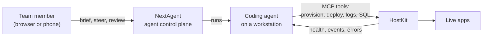
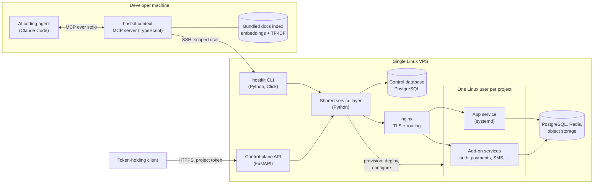

# HostKit

**A VPS platform built for AI coding agents to drive: they create, deploy, debug and operate full-stack apps on a real Linux server through MCP tools, without anyone opening an SSH session.**

---

## What it is

AI coding agents can write an app, but they usually stop at "now deploy it yourself." HostKit closes that gap. It turns one ordinary Linux server into a small hosting platform that an agent such as Claude Code operates directly: it provisions a project, turns on a database, login and payments, ships the code, waits for it to come up healthy, reads the logs and fixes what broke.

HostKit is Emergent's in-house platform, not a commercial product. Emergent's own tools run on it, and so do its client apps: [Kelleher HVAC](https://github.com/codeslayer44/kelleher-hvac-showcase), [Midlothian Mechanical](https://github.com/codeslayer44/midlothian-mechanical-showcase), [StoneSonic](https://github.com/codeslayer44/stone-sonic-showcase), [ARC Method Academy](https://github.com/codeslayer44/arc-method-academy-showcase) and [Buchanan Education Service](https://github.com/codeslayer44/buchanan-cpe-showcase) are all built from HostKit's shared packages and deployed to it.

For a client, that means your app does not start from a blank folder or a one-off server. It starts from the same tested foundation as every other Emergent app, ships through the same health-checked deploy pipeline, and runs in its own isolated account on a platform with backups, instant rollback and error diagnosis built in.

There is no Docker or Kubernetes. Each app is a plain Linux user with its own systemd service, subdomain and TLS certificate, which keeps the whole platform small enough to run, and reason about, on a single machine.

## Highlights

- **18 MCP tools an agent can call.** One `hostkit_deploy_local` call takes a folder on the agent's machine to a live, health-checked app: pre-flight checks, upload, optional install and build, an atomic switch to the new release, then a wait until the app answers healthy. If the project does not exist yet, it detects the runtime (Next.js, Node, Python or static) and provisions it with a database, auth and storage first. The same operations are also exposed over an authenticated HTTPS API for project-scoped tokens, including staged deploys of prebuilt artifacts with rollback.
- **Every client app starts from the same tested foundation.** New apps are scaffolded by `create-hostkit-app` on top of 30 shared `@hostkit/*` TypeScript packages: auth, API handlers, database, storage, payments, email, team permissions, PDF generation, a shop, sales tax and more. Pick the features and it generates a working Next.js app wired to HostKit's services, with login and password-reset flows, admin pages, checkout and typed CRUD routes from a one-line model definition. CI builds and packs every package on each change, and the libraries ship as one versioned release.
- **Database access agents cannot misuse.** Agent SQL runs as the project's own database role, one prepared statement per call, inside a transaction PostgreSQL itself holds read-only unless writes are explicitly requested. Results come back as typed JSON with row and size limits.
- **Zero-downtime rolling deploys.** The new release starts on a spare port next to the old one, must pass its health check, takes over traffic through a validated nginx reload, and only then is the old process drained. Any failure puts traffic back where it was.
- **Platform services in one command.** Auth (email and password, magic links, Google and Apple sign-in, RS256 JWTs, roles), Stripe Connect payments, Twilio SMS and voice, an LLM chatbot, booking, vector search, S3-compatible object storage, mail with DKIM, and an encrypted secrets portal.
- **Strict per-project boundaries.** Every app runs as its own Linux user. Tenant code, and anything that touches tenant-controlled files, runs as that user rather than as root. A project-scoped MCP server or API token can reach exactly one project; asking for another is refused before anything runs.
- **Built-in memory and self-repair.** Structured events with signed webhooks, error-pattern diagnosis with automatic fixes, auto-pause for projects stuck in a failure loop, and a shared solutions log so a problem one agent solved is searchable by every other project.

## HostKit + NextAgent

HostKit is one half of Emergent's agent tooling. [NextAgent](https://github.com/codeslayer44/nextagent-showcase) is where the team's coding agents work; HostKit is where what they build goes live.

Someone briefs an agent in NextAgent, from a laptop or a phone. The agent builds the app on its own machine, ships it to HostKit with one deploy call, waits for the health check, reads the logs if something breaks, fixes it, and reports back in the chat. Nobody opens a terminal or an SSH session at any point. NextAgent itself is a HostKit app, so the platform also hosts the tool that drives it.

## Architecture

**How a request flows.** The agent talks to a local MCP server over stdio. Read-heavy tools (project state, docs search) answer from a short-lived cache or from a search index shipped with the server, which saves SSH round trips. Everything that changes the server goes over a pooled SSH connection to the `hostkit` CLI. The CLI is a thin layer over a shared Python service layer, which is where the platform logic lives: it keeps platform state in PostgreSQL, renders systemd units and nginx sites from templates, and does all tenant-facing work as the tenant's own Linux user.

The HTTP API is a second front door onto the same services: it authenticates a short-lived admin JWT or a project token, rejects cross-project requests before any handler runs, and calls the same service layer the CLI uses, so both paths share one implementation.

On the app side, client code is built on the shared `@hostkit/*` packages, which include typed clients and helpers for these same platform services (auth, payments, storage, database), so an app talks to the platform through tested code rather than hand-written calls.

A deeper walk-through, including how apps are scaffolded from the packages, is in [docs/architecture.md](docs/architecture.md).

## Engineering notes

**PostgreSQL is the guard, not a regex.** Letting an agent run SQL is easy; letting it run SQL safely is not, because text scanning can be fooled by comments, dollar-quoting or a hidden `COMMIT`. HostKit still classifies the query up front for a friendly error, but the real enforcement is in the database: the statement is sent as a single prepared statement over the extended protocol (so nothing can be chained after it), reads run in a read-only transaction, and a write is committed only if PostgreSQL's own command tag says it was an INSERT, UPDATE, DELETE or MERGE. Anything else is rolled back and refused, and the connection is closed so no session state carries over.

**Root never acts on what a tenant controls.** A tenant can change anything in its own home directory at any moment, while deploys and restores are started by a privileged process. So every step that touches tenant files or runs tenant code (installs, builds, git clones, release swaps, database clients, health probes) first switches to the project's own Linux user with a clean environment and a bounded output buffer. If that switch cannot be verified, the operation stops; there is no fallback to running it as root.

**Deploys that fail safely.** Every deploy lands in a timestamped release directory and goes live through an atomic symlink swap, with the last five releases kept for instant rollback. In rolling mode the platform runs the new release as a temporary service on a spare port, waits for its health check, points nginx at it, drains and restarts the main service, then points nginx back. Each step emits a structured event, and the cleanup path undoes whatever partial state a failure left behind. nginx changes are tested before they are kept and restored if the reload fails, and critical sections such as a database restore hold termination signals so they can finish and report what actually happened.

**Guardrails shaped for agents.** Agents make predictable mistakes, so the deploy tool catches them before upload: it blocks packages that duplicate platform services (third-party auth SDKs, Firebase, MongoDB), adds Next.js standalone output and a health endpoint if they are missing, and warns about hard-coded ports or provider keys committed to the tree. Deploys are rate-limited and a project that keeps failing is auto-paused, which stops an agent from burning an afternoon in a redeploy loop. `hostkit_auth_guide` exists purely to stop agents from hand-rolling OAuth.

**Scope is a hard boundary, and a test enforces it.** When the MCP server is configured for one project, every tool resolves its target through one helper that refuses any other project with a stable `CROSS_PROJECT_BLOCKED` error. A coverage test scans every tool's source and fails if one uses a lookup that could sidestep that helper, so a new tool cannot quietly skip the check.

## Tech stack

| Layer | Technology |
|---|---|
| Platform CLI and services | Python 3.11+, Click, Rich, Jinja2 |
| Control-plane API | FastAPI, Uvicorn, PyJWT, Argon2 |
| Agent interface | TypeScript, Model Context Protocol SDK, ssh2 |
| Docs search | Transformers.js (MiniLM, CPU-only) with TF-IDF fallback |
| Data | PostgreSQL 16 (psycopg 3 for agent SQL), Redis, MinIO, Cloudflare R2 |
| Hosting substrate | Ubuntu, systemd, nginx, Let's Encrypt, Postfix and Dovecot |
| Add-on services | FastAPI and SQLAlchemy templates for auth, payments (Stripe Connect), SMS and voice (Twilio), chatbot, booking, vector search |
| Security primitives | AES-256-GCM with Argon2id key derivation (secrets), Fernet (environment variables at rest), HMAC-signed webhooks |
| Client app foundation | 30 `@hostkit/*` packages and the `create-hostkit-app` scaffolder (TypeScript, Next.js, Prisma, Zod), published as one versioned set |
| Quality | pytest, Vitest, Ruff, mypy (strict), GitHub Actions with hard release gates and real PostgreSQL and PostGIS integration suites |

## By the numbers

| | Platform | App packages |
|---|---|---|
| Commits | 142 (Feb 2026 to Oct 2026) | 53 (Feb 2026 to Oct 2026) |
| Lines of source | 184,674 | 22,832 |
| Tracked files | 656 | 347 |
| Test files | 183 | 4, plus a 7-case scaffolder build matrix and per-package checks |
| Languages | Python 95.1%, TypeScript 3.5% | TypeScript 95.7%, JavaScript 2.5% |
| Packages | | 30 libraries and the app scaffolder |

## About this repo

HostKit's source code is private. This repository documents what the project is and how it is built, so it can be shown without publishing the code.

Built by [Emergent AI Agency](https://emergentaiagency.com) (Ryan Chappell). If you have a project you would like built and run this way, get in touch through emergentaiagency.com.
