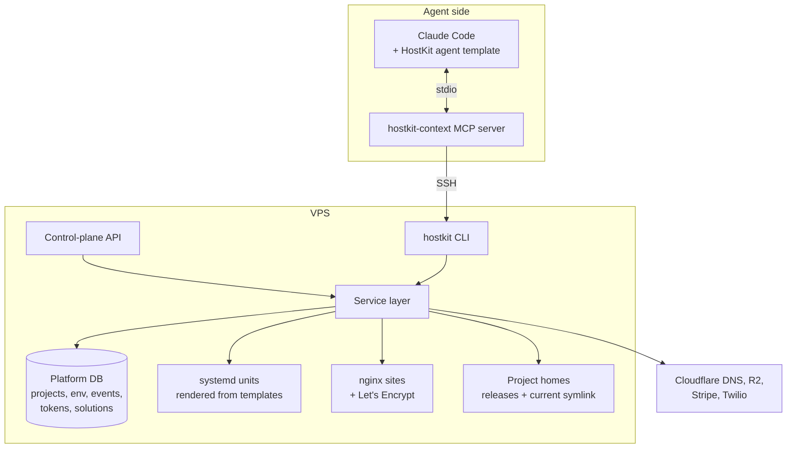
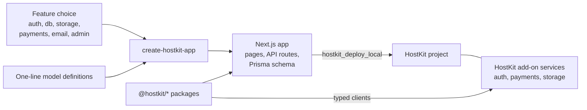
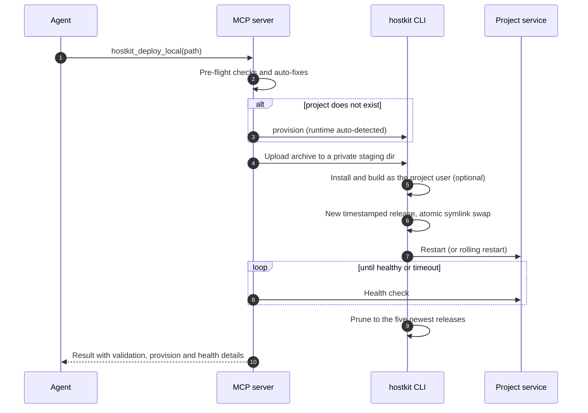
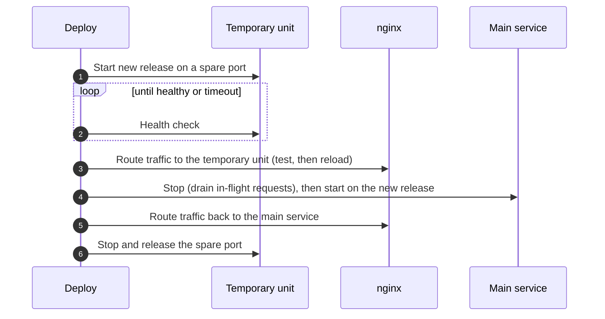

# HostKit architecture

This is a deeper look at how HostKit is put together: the moving parts, how client apps are built on it, how a deploy travels through them, and the decisions that shaped the design. It describes the private codebase; no source is reproduced here.

## Design goals

1. **An agent is the primary operator.** Every operation has a machine-readable form (`--json` on the CLI, typed JSON from every MCP tool, a uniform envelope from the API), and failures come back as stable error codes an agent can branch on.
2. **One server, no orchestration layer.** Linux users, systemd, nginx and PostgreSQL already provide processes, isolation, routing and storage. HostKit composes them instead of adding containers.
3. **Safe by construction, not by convention.** Limits that matter are enforced by the layer that owns them (PostgreSQL for SQL access mode, the kernel for process identity, a central resolver for project scope) rather than by checks an agent could talk its way around.

## Components



| Component | Role |
|---|---|
| **MCP server** (`hostkit-context`, TypeScript) | Runs next to the agent. Exposes 18 tools, keeps a pooled SSH connection, caches read-only state for a short time, and serves documentation search from an index shipped with the package. |
| **CLI** (`hostkit`, Python/Click) | The platform's command surface on the server: projects, deploys, rollbacks, env, databases, services, backups, DNS, mail, TLS, diagnostics. Commands return JSON for agents and readable tables for people. |
| **Service layer** (Python) | Where the logic lives. Both the CLI and the API call into it, so there is one implementation of each operation. |
| **Control-plane API** (FastAPI) | Authenticated HTTPS access to the same operations for a short-lived admin JWT or a project-scoped token. Routes are classified centrally, so a route is protected unless it is explicitly listed as public. |
| **Add-on service templates** | Self-contained FastAPI services that a project can switch on: auth, payments, SMS, voice, chatbot, booking, vector search, secrets portal. Each runs as its own systemd unit behind the project's nginx site. |
| **Agent template** | Starter settings and commands that teach a fresh coding agent how to work with HostKit. |
| **App packages** (`@hostkit/*`, TypeScript) | 30 shared libraries plus the `create-hostkit-app` scaffolder that client apps are built from. Kept in their own repository and published as one versioned set. |

## The project model

A project is a bundle of ordinary Linux primitives:

- a dedicated Linux user and home directory;
- a systemd service (plus one per enabled add-on) that runs as that user;
- an nginx site with its own subdomain and a Let's Encrypt certificate, optionally with custom domains;
- a PostgreSQL database and role, a Redis database and an object-storage bucket when enabled;
- environment variables stored encrypted in the platform database.

`provision` creates all of this in one step with sensible defaults (database, auth and storage on); the lower-level `project create` makes each piece opt-in. Four runtimes are supported: Next.js, Node, Python and static sites.

## App foundation: shared packages and the scaffolder

The server side of HostKit runs apps; the `@hostkit/*` packages are what those apps are made of. Every Emergent client app starts from the same scaffolder and the same libraries, so login, payments, uploads and admin screens are code that has already shipped in other apps rather than something rewritten per project.



**The scaffolder.** `create-hostkit-app` takes a project name, a list of features and optional model definitions, and writes a complete Next.js app: a health route and standalone build output (what the deploy pipeline expects), sign-in, sign-up, magic-link, password-reset and email-verification flows when auth is on, a Prisma schema and seed script when a database is on, checkout pages and payment webhooks when payments are on, an admin area if requested, and list and detail API routes (plus admin pages, with the admin option) for each model. A model is described in one line, such as `Post(title:String,body:String)`, and becomes a table, typed routes and an admin screen.

**The libraries.** The 30 packages fall into a few groups:

| Group | Packages |
|---|---|
| Platform plumbing | `config`, `api` (request handlers, validation, pagination, safe error responses), `db` (Prisma client and config), `storage` (S3-compatible uploads), `deploy` (Next.js config and health handler), `log`, `sse`, `ws` |
| Identity and access | `auth` (client for HostKit's auth service, session handling, middleware, React hooks), `local-auth`, `team` (owner, admin and employee permission presets with scoped switches), `agent-api` (bearer-token access for automated agents) |
| Commerce | `payments` (client for HostKit's payment service), `stripe-direct` (for clients with their own Stripe account), `shop`, `cart`, `coupons`, `coupons-stripe`, `tax` (database-driven US sales tax) |
| Content and communication | `email`, `email-resend` (with a delivery audit trail), `webmail` (IMAP and SMTP with credentials encrypted at rest), `blog`, `markdown`, `pdf` (HTML to paginated PDF with a render cache), `agreements` (versioned agreements with e-signature) |
| App building blocks | `patterns` (CRUD, contact, newsletter, search and admin-guard handlers), `settings` (admin-managed site settings and runtime secrets), `workflow` (ordered-stage state machine), `bot-companion` (multi-bot chat workspace with per-user permissions) |

**Keeping it trustworthy.** On every change, CI installs the workspace, runs the unit tests, builds every package in dependency order, packs each one and checks that every path it exports actually exists, then runs a per-package validation pass. A separate smoke matrix runs the scaffolder across seven feature combinations (from a bare auth-and-database app to one with payments, email, storage and admin together) and checks that each result installs, generates its Prisma client, type-checks and completes a production build. Publishing runs only from `main` and produces one version for the whole set, so an app can pin a single, known-good release of its whole foundation.

## Deploy pipeline



The pre-flight step is written for the mistakes agents actually make. It refuses packages that duplicate a platform service (third-party auth SDKs, Firebase, MongoDB and similar), adds `output: 'standalone'` to a Next.js config that lacks it, creates a health route if there is none, and warns about hard-coded ports or provider keys in the tree. The result an agent gets back explains each of these, so it can correct its own code.

```ts
// illustrative: the shape of a deploy result an agent receives
type DeployResult = {
  success: boolean;
  deployed: boolean;
  healthy: boolean;
  auto_provisioned: boolean;
  validation: {
    errors:     { code: string; message: string }[]; // e.g. BANNED_DEPENDENCY
    warnings:   { code: string; message: string }[]; // e.g. HARDCODED_PORT
    auto_fixed: { code: string; message: string }[]; // e.g. added health route
  };
};
```

Deploys are rate-limited per project, and a project that fails repeatedly inside a time window is auto-paused with a reason, which stops a confused agent from redeploying in a loop. Before risky operations the platform can take a database checkpoint, and a code rollback is a symlink swap back to the previous release.

The HTTP API has its own deploy path for clients that do not use SSH: a **deploy session** accepts a prebuilt, runtime-ready archive, stages it, and flips it live, with an expiry janitor that clears abandoned sessions. Builds happen on the client, so the server never runs a package manager on that path.

### Rolling restarts

Projects can opt into a zero-downtime mode:



Each step emits a structured event (`deploy:rolling_started`, `deploy:rolling_upstream_swapped` and so on), and any abort reverses the partial state it left behind. The one deliberate exception: if the main service fails to restart, traffic stays on the healthy temporary unit and the platform raises a critical event for a human, because the site is still up and an automatic "fix" would take it down.

## Boundaries and scoping

HostKit has three kinds of caller: a platform administrator, an **operator** (typically an agent trusted to manage many projects through an allow-list of commands), and a **project** identity that can touch only its own project. The design keeps those apart in several layers:

- **MCP scope.** A server configured for one project resolves every tool's target through a single helper that refuses any other project with `CROSS_PROJECT_BLOCKED`. A coverage test scans every tool's source and fails if one uses a lookup that could sidestep that helper.
- **API scope.** Project tokens are bound to one project; a request that names a different project is rejected before the route handler runs. Tokens are shown once at creation, can be rotated or revoked immediately, and are never returned by listing or status calls.
- **Process identity.** Tenant code runs only as the tenant's Linux user, and units for tenant processes set `NoNewPrivileges`. Platform steps that need to read or run anything the tenant controls drop to that user first, and stop rather than continue as root if the drop cannot be confirmed.
- **Database identity.** Agent SQL runs as the project's own database role, never as a platform superuser.
- **Secrets.** Platform keys live outside tenant environments; service-owned variables such as the database URL cannot be overwritten through the project environment interface; secret values are masked on read.

### Agent SQL

`hostkit_db_query` (and the matching API route) is a small case study in putting the check where it cannot be bypassed:

1. A text classifier gives a fast, friendly refusal for obvious misuse (multiple statements, DDL, `COPY`, psql meta-commands).
2. The real limit is PostgreSQL. The statement goes over the extended query protocol as one prepared statement, which PostgreSQL refuses to prepare if it contains more than one statement. psycopg 3 is used here specifically because psycopg2 cannot send a prepared statement.
3. Reads run in a read-only transaction on a session that defaults to read-only, so any write fails inside the database whatever the text looked like.
4. Writes require an explicit flag and are committed only if the server's command tag is INSERT, UPDATE, DELETE or MERGE; everything else is rolled back.
5. Results are fetched from a server-side cursor, capped by row count and by bytes, and returned as typed JSON. Each connection serves one statement and is closed, so no session state survives.

## Knowledge and self-repair

- **Docs search.** The MCP server ships a pre-built index of HostKit documentation. Queries are embedded locally with a small MiniLM model through Transformers.js and scored 70% semantic and 30% TF-IDF; if the model is unavailable the search falls back to keywords alone. Everything runs on the developer's machine, on CPU, with no search service to host.
- **Solutions log.** `hostkit_solutions` lets an agent record a problem and its fix, tagged and attributed to a project, and lets every other agent search it. A fix found once is available to the whole fleet.
- **Diagnosis.** `hostkit_fix` matches an error against known failure patterns (502s, failed health checks, missing dependencies, auth and database problems) and applies the matching remedy. `hostkit_status` folds health, services, URL, env variable names and recent logs into one call.
- **Events.** Deploys, health changes, env changes and service actions are recorded as structured events with severity and actor. They are queryable through `hostkit_events` and can be pushed to webhooks signed with HMAC and retried on failure. Emitting an event never blocks or fails the operation that produced it.

## Data protection

- **Environment variables** are stored in the platform database, encrypted at rest with Fernet, with key rotation and diffing built in.
- **Secrets** handed to the secrets portal are encrypted with AES-256-GCM using Argon2id key derivation, and entered through a portal reached by an expiring magic link.
- **Backups** cover project databases (including the auth database), app files and environment, can go to Cloudflare R2, and have a verify step that checks an archive without restoring it. Dump sizes and output are bounded, and restores run as the project's own database role.
- **Checkpoints** take a point-in-time database snapshot before risky operations such as migrations.
- **Sandboxes** create temporary clones of a project for experiments that should not touch the real one.

## Testing and CI

The repository carries 183 test files. Most of the Python suite runs without a live server, but the parts that depend on PostgreSQL behaviour run against real servers: CI starts PostgreSQL 16 and PostGIS containers and runs the opt-in integration suites against both, including a leg pinned to the lowest supported psycopg version.

Pull requests and pushes to `main` run through a single aggregate job that passes only when every Python release gate has succeeded. Separate gates build the CLI as a wheel, install it into an isolated environment, and check that the installed package (not the source tree) can render its systemd templates and run its backup commands. The TypeScript MCP server has its own Vitest suites, including the cross-project scope guard and the SQL-tool behaviour. The app packages have their own pipeline, described under *App foundation* above.

## Decisions worth noting

- **Systemd and Linux users instead of containers.** On a single machine, users, units and `NoNewPrivileges` give real separation with almost no overhead, and every piece is something an agent (or a human at 2 a.m.) can inspect with standard tools.
- **The CLI is the contract.** The MCP server and the API are thin; the platform logic lives in one Python service layer. New capabilities appear in the CLI first and are then exposed to agents.
- **Shared foundation over per-project code.** Client apps are generated from one scaffolder and built on one set of versioned packages, so a fix or a hardening change is made once, in a tested library, instead of separately in each app.
- **Builds move to the client.** The newer API deploy path accepts only prebuilt artifacts, which keeps package managers and arbitrary build scripts off the server.
- **Fail visibly.** Long multi-step changes (nginx swaps, database restores) hold termination signals across their critical section, then report exactly what completed. A run that cannot confirm its own safety preconditions stops with an explanation rather than guessing.
